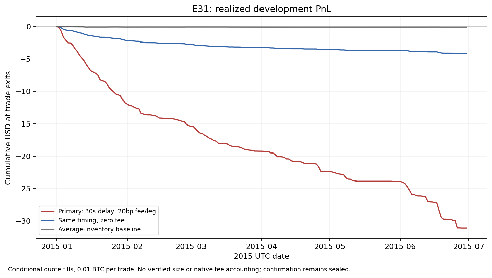
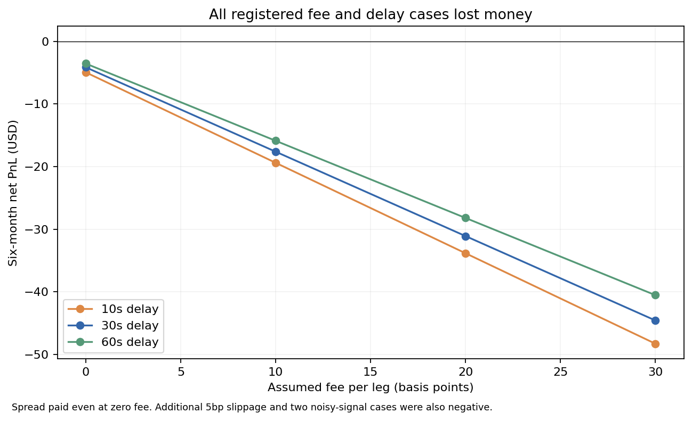

# Bitfinex Order Flow Pressure

The fixed strategy lost money in every registered development case. With a 30-second entry delay and assumed 20bp fee on each leg, it completed 2,777 trades and lost $31.10. The same timing lost $4.15 even with fees set to zero. The spread-paying zero-fee counterpart also lost money.

This is a conditional historical quote test, not an actual trading loss. Missing order sizes, uncertain venue quote age and unverified native fee accounting prevent an executable-profit claim. The negative result closes this particular policy; it does not establish that all imbalance strategies or Bitcoin markets lack an edge.

## What was tested

The hypothesis was that a bid-heavy displayed book could signal a short upward price adjustment. Gould and Bonart studied next-tick prediction from best-queue imbalance on Nasdaq. This test instead used a publisher's top-60-level imbalance for Bitfinex BTC/USD, so it is a related hypothesis rather than a replication. [Paper](https://arxiv.org/abs/1512.03492)

The January-June 2015 development window contained 5,594,727 rows. Two failed the prospectively fixed quote/imbalance checks and were skipped. A ten-second decision grid used only prior valid rows at most five collector-seconds old. A signal at imbalance 0.5 or higher scheduled a 0.01 BTC purchase at the later ask. The scheduled sale used a later bid, with delays and a cooldown. Exits remained open through missing observations rather than discarding difficult trades. The longest primary holding period was 310 seconds.

Starting cash was $10,000, with no borrowing or cash replenishment. Position size was deliberately small; capital return is therefore not a capacity estimate. July-September prices were not converted or used. The failed development screen leaves that confirmation window sealed.

## Results and uncertainty

| Primary result | Value |
| --- | ---: |
| Completed round trips / exit dates | 2,777 / 143 |
| Net PnL / starting-capital return | -$31.1003 / -0.3110% |
| Assumed trading fees | $26.9480 |
| Zero-fee counterpart, still paying spread | -$4.1523 |
| Average-inventory baseline | -$0.0753 |
| Mean daily net PnL | -$0.1718 |
| Unadjusted 95% bootstrap interval, daily net | [-$0.2220, -$0.1246] |
| Family-adjusted one-sided lower bound, daily net | -$0.2492 |
| Family-adjusted lower bound versus baseline | -$0.2481 |



All twelve fee/delay combinations were negative, as were the additional slippage case and both noisy-signal cases. The zero-fee primary loss was approximately 6.16bp of total entry notional. No parameter or signal reversal was selected after seeing outcomes.

The uncertainty calculation used all 181 daily values, including zero-trade days, and 20,000 circular seven-day block resamples. Pairing preserved the strategy/baseline comparison. The one-sided lower bounds used a correction for 15 cases and two contrasts. These are within-family bounds, not a correction for every adaptive inquiry in the lab. Resampling observed daily outcomes is not independent evidence of how a future market will behave.



## Data and practical limits

Source: BitcoinPriceData's 2014-2015 six-venue series, v1.0, released under CC BY 4.0. The Bitfinex archive's 72,591,413 bytes and SHA-256 matched the publisher. Prices were used in published major units. The source's zero imbalance can mean genuine balance or a failed depth fetch; this policy treated it as neutral. [Release and attribution](https://bitcoinpricedata.com/downloads/), [methodology](https://bitcoinpricedata.com/methodology/)

The archive has collector timestamps and best quotes, without positive-size availability, queue messages or exchange clocks. The fee model charges proportional fees in USD and assumes a full fill at each selected quote. Bitfinex's dated August 2015 announcement supports a 20bp base rate from August 17, not a verified January-June schedule. Zero-fee and other cost cases expose that uncertainty rather than resolving it. [Dated fee announcement](https://blog.bitfinex.com/announcements/new-commission-structure/)

Custody losses, banking fees, venue eligibility and complete funding/access conditions are not modelled. The baseline scales a daily long position to average held inventory and is an analytic comparison, not a claim that arbitrarily small fractional orders could be traded. None of these results qualify a present-day or prop-firm advantage.

## Verification and disposition

Protocol b7db68a9 and reviewed implementation 679a2ebc preceded numerical price/imbalance interpretation. Fourteen synthetic checks passed, including delayed fills, both trading costs, gaps, cash reconciliation, noise reproducibility and a poisoned confirmation-boundary row. The original offline replay also passed. A separate event-search algorithm reconstructed all 2,777 primary trades and terminal cash. Independent calculations reproduced all 15 saved trade ledgers, daily inventory baselines and 30 adjusted bootstrap bounds. Nonprimary signal decisions rely on the saved trade lists; cache causality relies on the reviewed loader, not a second raw-price parse. No execution qualification follows from this audit.

The registered development rule failed. July-September 2015 remains reserved and untested. No threshold, date or direction changes were made after seeing these results.

## Reproduction

Install the packages in requirements.txt. The included synthetic checks run without market data:

```text
python -m unittest test_e31_engine test_e31_study
```

A full offline reconstruction needs the original bayesdata_bitfinex.csv.gz from the attributed release. Its SHA-256 is 9883d1e66c87e6694144bea22ee8b5a09af70c5cf3e06884553d453e979665d5. Raw archives and private research history are not included here.

```text
python reproduce.py --data /path/to/bayesdata_bitfinex.csv.gz
```

That command creates a new replay_workspace, runs the frozen policy and separate audit, regenerates the figures, and compares all 15 numerical cases with the saved results. It performs no network requests or trading. It refuses to overwrite an existing workspace. The original research run evaluated development once; reproduction repeats the same fixed calculation, not model selection or a new experiment.

Saved trades, daily vectors and summary outputs are under evidence/e31. The independent audit rebuilds primary decisions from the development-only quote cache. Other cells' signals rely on their saved trade lists; their accounting, exposure baselines and bootstrap calculations are independently checked. No raw source prices outside January-June are interpreted by the runner.
